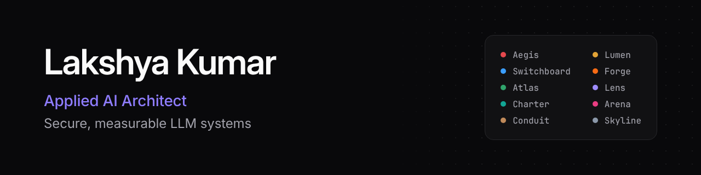

<picture>
  <source media="(prefers-color-scheme: dark)" srcset="assets/banner-dark.png">
  <source media="(prefers-color-scheme: light)" srcset="assets/banner-light.png">
  
</picture>

**I design and build applied AI systems:** the gateway in front of the model, the retrieval behind the answer, 
the router that picks the model, the runtime that survives a crash, and the evaluation loop that says when quality dropped.

## The Enterprise AI Platform

Ten projects in one repository, [**personal-projects**](https://github.com/kumarlakshya24/personal-projects). Each one tackles a hard part of putting language models in front of employees and agents. Each has an architecture document, decision records with the trade-offs, tests, and a demo that runs offline on synthetic data with no API key.

| | Project | What it does | Measured |
|:-:|:--|:--|:--|
|  | [**Aegis**](https://github.com/kumarlakshya24/personal-projects/tree/main/secure-ai-gateway) | Security gateway: replaces personal data with placeholders before a prompt leaves, checks agent tool calls, keeps a tamper-evident audit log | 97.0% recall, 95.5% precision on an 84-case red-team suite |
|  | [**Lumen**](https://github.com/kumarlakshya24/personal-projects/tree/main/rag-knowledge-assistant) | Knowledge assistant: cited answers from company documents, with access control inside the retrieval query | Answer accuracy 63% → 89%; restricted-document leaks 100% → 0% |
|  | [**Switchboard**](https://github.com/kumarlakshya24/personal-projects/tree/main/switchboard) | Model router: the cheapest model that is good enough, under a versioned policy | 65% cheaper than always using the premium model, on answered requests |
|  | [**Forge**](https://github.com/kumarlakshya24/personal-projects/tree/main/forge) | Sandbox for agent tool calls: refuses a dangerous call before a process exists | 55 / 55 eval cases; 41 protections locked by a regression gate |
|  | [**Atlas**](https://github.com/kumarlakshya24/personal-projects/tree/main/atlas) | Durable multi-agent workflows: event log, idempotency keys, sagas | 16 / 16 workflows succeed against 3 / 16 for a naive agent; 0 duplicate charges after a crash |
|  | [**Lens**](https://github.com/kumarlakshya24/personal-projects/tree/main/lens) | Observability and evaluation: traces, a sampled judge, drift, error budgets, a CI quality gate | Judge agreement κ 0.76 with hand labels; a seeded regression is blocked |
|  | [**Charter**](https://github.com/kumarlakshya24/personal-projects/tree/main/charter) | Governance control plane: which model may run on whose data, in which region | 10 met, 4 partial, 3 gaps on the control matrix |
|  | [**Arena**](https://github.com/kumarlakshya24/personal-projects/tree/main/arena) | Fine-tune, RAG, or prompt: one labeled set, four ways to answer, and a memo that says which to ship | RAG 25 / 25 cited; the adapter is stale on 3 / 3 amended policies |
|  | [**Conduit**](https://github.com/kumarlakshya24/personal-projects/tree/main/conduit) | Embedding pipeline: one model per index generation, a guarded swap, erasure by person | Recall@1 20 / 20 after the swap; 0 links after a rebuild |
|  | [**Skyline**](https://github.com/kumarlakshya24/personal-projects/tree/main/skyline) | Cloud landing zone: private accounts, a key per tenant, a price per 1,000 requests | 20 / 20 invariants; $6.26 against $9.20 per 1,000 at 100,000 requests a day (projected) |

Every number comes from an evaluation report committed in that project. Start with the [platform overview](https://github.com/kumarlakshya24/personal-projects#readme), which shows how the ten fit together.

## What I work with

Python 3.12 · FastAPI · PostgreSQL and pgvector · Redis · SQLite · ONNX Runtime · OpenTelemetry-style tracing · Docker Compose · GitHub Actions · AWS (multi-account networking, KMS, Bedrock)
