<a href="https://github.com/kumarlakshya24/enterprise-ai-platform"><picture><source media="(max-width: 600px) and (prefers-color-scheme: light)" srcset="assets/hero-light-mobile.svg"><source media="(max-width: 600px)" srcset="assets/hero-dark-mobile.svg"><source media="(prefers-color-scheme: light)" srcset="assets/hero-light.svg"></picture></a>

<div align="center">

**I design and build applied AI systems:** the gateway in front of the model, the retrieval behind the answer,
the router that picks the model, the runtime that survives a crash, and the evaluation loop that says when quality dropped.

[](https://www.linkedin.com/in/lakshyakumar24/)
[](https://github.com/kumarlakshya24/enterprise-ai-platform)

</div>

## The Enterprise AI Platform

Ten projects in one repository, [**enterprise-ai-platform**](https://github.com/kumarlakshya24/enterprise-ai-platform). Each one tackles a hard part of putting language models in front of employees and agents. Each has an architecture document, decision records with the trade-offs, tests, and a demo that runs offline on synthetic data with no API key. Each card opens that project's code.

<p align="center">
<a href="https://github.com/kumarlakshya24/enterprise-ai-platform/tree/main/secure-ai-gateway"><picture><source media="(max-width: 600px) and (prefers-color-scheme: light)" srcset="assets/cards/aegis-light-mobile.svg"><source media="(max-width: 600px)" srcset="assets/cards/aegis-dark-mobile.svg"><source media="(prefers-color-scheme: light)" srcset="assets/cards/aegis-light.svg"></picture></a>
<a href="https://github.com/kumarlakshya24/enterprise-ai-platform/tree/main/rag-knowledge-assistant"><picture><source media="(max-width: 600px) and (prefers-color-scheme: light)" srcset="assets/cards/lumen-light-mobile.svg"><source media="(max-width: 600px)" srcset="assets/cards/lumen-dark-mobile.svg"><source media="(prefers-color-scheme: light)" srcset="assets/cards/lumen-light.svg"></picture></a>
<a href="https://github.com/kumarlakshya24/enterprise-ai-platform/tree/main/switchboard"><picture><source media="(max-width: 600px) and (prefers-color-scheme: light)" srcset="assets/cards/switchboard-light-mobile.svg"><source media="(max-width: 600px)" srcset="assets/cards/switchboard-dark-mobile.svg"><source media="(prefers-color-scheme: light)" srcset="assets/cards/switchboard-light.svg"></picture></a>
<a href="https://github.com/kumarlakshya24/enterprise-ai-platform/tree/main/forge"><picture><source media="(max-width: 600px) and (prefers-color-scheme: light)" srcset="assets/cards/forge-light-mobile.svg"><source media="(max-width: 600px)" srcset="assets/cards/forge-dark-mobile.svg"><source media="(prefers-color-scheme: light)" srcset="assets/cards/forge-light.svg"></picture></a>
<a href="https://github.com/kumarlakshya24/enterprise-ai-platform/tree/main/atlas"><picture><source media="(max-width: 600px) and (prefers-color-scheme: light)" srcset="assets/cards/atlas-light-mobile.svg"><source media="(max-width: 600px)" srcset="assets/cards/atlas-dark-mobile.svg"><source media="(prefers-color-scheme: light)" srcset="assets/cards/atlas-light.svg"></picture></a>
<a href="https://github.com/kumarlakshya24/enterprise-ai-platform/tree/main/lens"><picture><source media="(max-width: 600px) and (prefers-color-scheme: light)" srcset="assets/cards/lens-light-mobile.svg"><source media="(max-width: 600px)" srcset="assets/cards/lens-dark-mobile.svg"><source media="(prefers-color-scheme: light)" srcset="assets/cards/lens-light.svg"></picture></a>
<a href="https://github.com/kumarlakshya24/enterprise-ai-platform/tree/main/charter"><picture><source media="(max-width: 600px) and (prefers-color-scheme: light)" srcset="assets/cards/charter-light-mobile.svg"><source media="(max-width: 600px)" srcset="assets/cards/charter-dark-mobile.svg"><source media="(prefers-color-scheme: light)" srcset="assets/cards/charter-light.svg"></picture></a>
<a href="https://github.com/kumarlakshya24/enterprise-ai-platform/tree/main/arena"><picture><source media="(max-width: 600px) and (prefers-color-scheme: light)" srcset="assets/cards/arena-light-mobile.svg"><source media="(max-width: 600px)" srcset="assets/cards/arena-dark-mobile.svg"><source media="(prefers-color-scheme: light)" srcset="assets/cards/arena-light.svg"></picture></a>
<a href="https://github.com/kumarlakshya24/enterprise-ai-platform/tree/main/conduit"><picture><source media="(max-width: 600px) and (prefers-color-scheme: light)" srcset="assets/cards/conduit-light-mobile.svg"><source media="(max-width: 600px)" srcset="assets/cards/conduit-dark-mobile.svg"><source media="(prefers-color-scheme: light)" srcset="assets/cards/conduit-light.svg"></picture></a>
<a href="https://github.com/kumarlakshya24/enterprise-ai-platform/tree/main/skyline"><picture><source media="(max-width: 600px) and (prefers-color-scheme: light)" srcset="assets/cards/skyline-light-mobile.svg"><source media="(max-width: 600px)" srcset="assets/cards/skyline-dark-mobile.svg"><source media="(prefers-color-scheme: light)" srcset="assets/cards/skyline-light.svg"></picture></a>
</p>

<details>
<summary><b>All ten results in one table</b></summary>
<br>

| | Project | What it does | Measured |
|:-:|:--|:--|:--|
|  | [**Aegis**](https://github.com/kumarlakshya24/enterprise-ai-platform/tree/main/secure-ai-gateway) | Security gateway: replaces personal data with placeholders before a prompt leaves, checks agent tool calls, keeps a tamper-evident audit log | 97.0% recall, 95.5% precision on an 84-case red-team suite |
|  | [**Lumen**](https://github.com/kumarlakshya24/enterprise-ai-platform/tree/main/rag-knowledge-assistant) | Knowledge assistant: cited answers from company documents, with access control inside the retrieval query | Answer accuracy 63% → 89%; restricted-document leaks 100% → 0% |
|  | [**Switchboard**](https://github.com/kumarlakshya24/enterprise-ai-platform/tree/main/switchboard) | Model router: the cheapest model that is good enough, under a versioned policy | 65% cheaper than always using the premium model, on answered requests |
|  | [**Forge**](https://github.com/kumarlakshya24/enterprise-ai-platform/tree/main/forge) | Sandbox for agent tool calls: refuses a dangerous call before a process exists | 55 / 55 eval cases; 41 protections locked by a regression gate |
|  | [**Atlas**](https://github.com/kumarlakshya24/enterprise-ai-platform/tree/main/atlas) | Durable multi-agent workflows: event log, idempotency keys, sagas | 16 / 16 workflows succeed against 3 / 16 for a naive agent; 0 duplicate charges after a crash |
|  | [**Lens**](https://github.com/kumarlakshya24/enterprise-ai-platform/tree/main/lens) | Observability and evaluation: traces, a sampled judge, drift, error budgets, a CI quality gate | Judge agreement κ 0.76 with hand labels; a seeded regression is blocked |
|  | [**Charter**](https://github.com/kumarlakshya24/enterprise-ai-platform/tree/main/charter) | Governance control plane: which model may run on whose data, in which region | 10 met, 4 partial, 3 gaps on the control matrix |
|  | [**Arena**](https://github.com/kumarlakshya24/enterprise-ai-platform/tree/main/arena) | Fine-tune, RAG, or prompt: one labeled set, four ways to answer, and a memo that says which to ship | RAG 25 / 25 cited; the adapter is stale on 3 / 3 amended policies |
|  | [**Conduit**](https://github.com/kumarlakshya24/enterprise-ai-platform/tree/main/conduit) | Embedding pipeline: one model per index generation, a guarded swap, erasure by person | Recall@1 20 / 20 after the swap; 0 links after a rebuild |
|  | [**Skyline**](https://github.com/kumarlakshya24/enterprise-ai-platform/tree/main/skyline) | Cloud landing zone: private accounts, a key per tenant, a price per 1,000 requests | 20 / 20 invariants; $6.26 against $9.20 per 1,000 at 100,000 requests a day (projected) |

</details>

<details>
<summary><b>How the ten fit together</b></summary>
<br>

**The request path.** Who a person or an agent talks to, and what each call passes through.

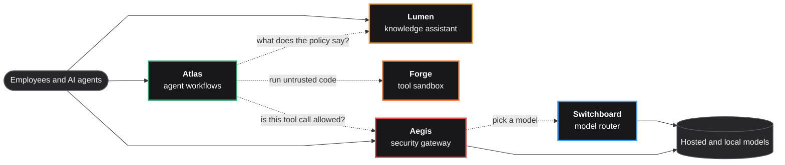

**Knowledge and data.** How documents reach the search index, and how the ways of answering are compared.

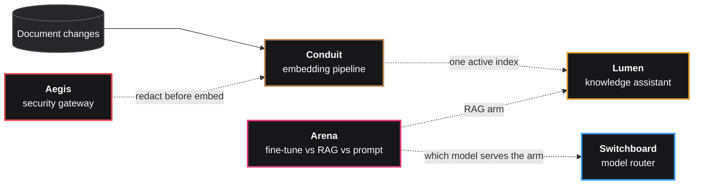

**Oversight and where it runs.** What watches the platform, what governs it, and the cloud layout it would land on.

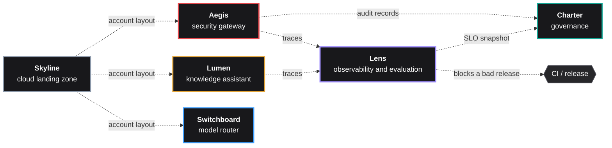

<sub>Dashed arrows are the documented contracts between projects. Which ones are live, and which are tested against a stand-in, is in <a href="https://github.com/kumarlakshya24/enterprise-ai-platform#-how-the-projects-connect">How the projects connect</a>.</sub>

</details>

<details>
<summary><b>Watch them run</b></summary>
<br>

<details><summary><b>Aegis</b></summary>
<br>

<sub>The same complaint sent to a chatbot directly and through Aegis; the model only sees placeholders.</sub>
</details>

<details><summary><b>Lumen</b></summary>
<br>

<sub>Two employees ask the same question and each gets their own team's policy, with citations.</sub>
</details>

<details><summary><b>Switchboard</b></summary>
<br>

<sub>One prompt under four routing policies, hard math to the premium model, a confidential note pinned to the local model.</sub>
</details>

<details><summary><b>Forge</b></summary>
<br>

<sub>An allowed sum, a path-traversal denial, an import denial, and the regression gate refusing a weaker policy.</sub>
</details>

<details><summary><b>Atlas</b></summary>
<br>

<sub>A worker is killed right after a ledger debit; resume heals the step and the ledger still shows one debit.</sub>
</details>

<details><summary><b>Lens</b></summary>
<br>

<sub>SLO cards, a quality drop, drift alerts, a blocked tool span, and a seeded bad prompt failing the CI gate.</sub>
</details>

<details><summary><b>Charter</b></summary>
<br>

<sub>The auditor desk, a residency deny on the US model, the same request allowed after the residency file is removed, and the control matrix.</sub>
</details>

<details><summary><b>Arena</b></summary>
<br>

<sub>A weekly desk ships RAG, the refund window is 30 days cited and 14 days stale, then volume flips the adapter and an 80 ms SLO leaves the student.</sub>
</details>

<details><summary><b>Conduit</b></summary>
<br>

<sub>Events fill one index generation, a second embedding model catches up, reads swap, and a forgotten subject stays at zero after replay.</sub>
</details>

<details><summary><b>Skyline</b></summary>
<br>

<sub>Six accounts, the cost per thousand requests as volume changes, then a security group opened to the world failing the gate.</sub>
</details>

</details>

<details>
<summary><b>Run one on your laptop</b></summary>
<br>

Every project runs offline on synthetic data, with no API key. Forge, for example:

```bash
git clone https://github.com/kumarlakshya24/enterprise-ai-platform
cd enterprise-ai-platform/forge
make install && make demo
```

</details>

Every number comes from an evaluation report committed in that project. Start with the [platform overview](https://github.com/kumarlakshya24/enterprise-ai-platform#readme), which shows how the ten fit together.

## Built at AWS

[**sample-agentic-phishing-detection**](https://github.com/aws-samples/sample-agentic-phishing-detection) is an open-source AWS sample I built. Paste a link and get an explained phishing verdict in about 20 seconds. Three specialist agents check the link, the page and the page's code at the same time in an isolated cloud browser, and an orchestrator weighs their evidence. It runs in your own AWS account and deploys with AWS CDK.

<a href="https://github.com/aws-samples/sample-agentic-phishing-detection"><picture><source media="(max-width: 600px) and (prefers-color-scheme: light)" srcset="assets/cards/phishing-light-mobile.svg"><source media="(max-width: 600px)" srcset="assets/cards/phishing-dark-mobile.svg"><source media="(prefers-color-scheme: light)" srcset="assets/cards/phishing-light.svg"></picture></a>

<details>
<summary><b>Measured results</b></summary>
<br>

407 live URLs, measured on November 3, 2026. 188 were phishing pages from a public feed that day and 219 were legitimate pages.

| Measure | Result | Against the previous default |
| --- | --- | --- |
| Phishing caught (recall) | **88.3%** (166 of 188) | Same, within run-to-run noise |
| False positive rate | **4.6%** (10 of 219) | Same, within run-to-run noise |
| Median scan time | **18.6 s** | 51% faster |
| p90 scan time | **31.2 s** | 57% faster |
| Model cost per scan (mean) | **$0.090** | 33% lower |

How it was measured is in [docs/evaluation.md](https://github.com/aws-samples/sample-agentic-phishing-detection/blob/main/docs/evaluation.md).

</details>

<details>
<summary><b>How a scan works</b></summary>
<br>

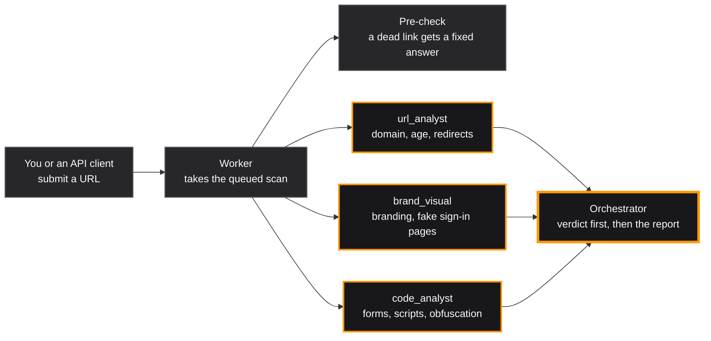

The specialists run on Amazon Bedrock AgentCore Runtime and open the page in AgentCore Browser, so it never loads on your machine. The orchestrator gives the verdict first and then writes a plain-language report, which an Amazon Bedrock guardrail screens.

</details>

<details>
<summary><b>Watch it run</b></summary>
<br>

<a href="https://github.com/aws-samples/sample-agentic-phishing-detection/blob/main/docs/media/demo.mp4"></a>
<sub>A 25-second excerpt. The <a href="https://github.com/aws-samples/sample-agentic-phishing-detection/blob/main/docs/media/demo.mp4">full 4-minute demo</a> has narration.</sub>

</details>

<details>
<summary><b>Deploy it in your AWS account</b></summary>
<br>

You need AWS credentials, Python 3.13 with uv, Node.js 22, Docker or Finch, and Amazon Bedrock access to Claude Opus 5.5 and Claude Sonnet 5.5. One AWS CDK command deploys it, in 8 to 16 minutes the first time, and one tears it down. The stacks cost about $14 to $15 a month while idle, so delete them when you're done. Step by step: [Quick start](https://github.com/aws-samples/sample-agentic-phishing-detection#quick-start).

</details>

## What I work with

Python 3.12 · FastAPI · PostgreSQL and pgvector · Redis · SQLite · ONNX Runtime · OpenTelemetry-style tracing · Docker Compose · GitHub Actions · AWS (multi-account networking, KMS, Bedrock, Bedrock AgentCore, CDK) · Strands Agents
